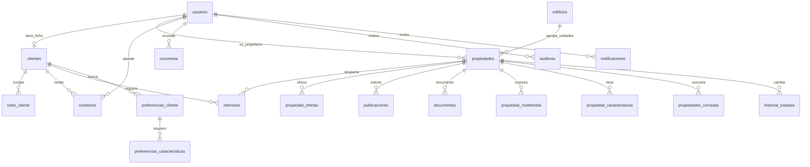
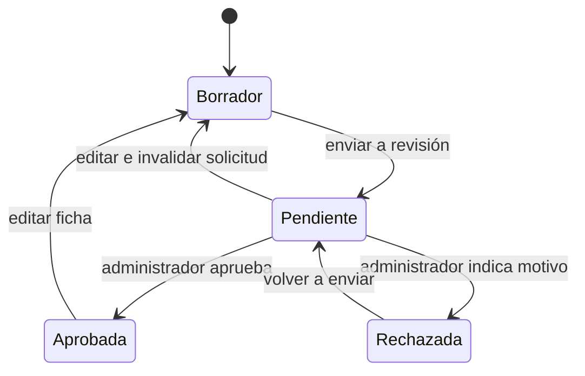

# Modelo y reglas principales

## Flujo de publicación

La revisión y la actualización de la ficha se ejecutan dentro de la misma transacción. Las operaciones sobre una propiedad bloquean su fila antes de modificarla para evitar dobles revisiones o cierres. Si falla un dato relacionado, la operación completa se revierte.

## Permisos

| Acción | Invitado | Cliente | Agente | Administrador |
|---|---|---|---|---|
| Catálogo aprobado | Sí | Sí | Sí | Sí |
| Solicitar publicación | No | Propia | Sí | Sí |
| Editar propiedades | No | Propias | Sí | Sí |
| Ver documentos privados | No | Propios | Sí | Sí |
| Aprobar/rechazar | No | No | No | Sí |
| Gestionar fichas y contactos | No | Sus intereses y búsqueda | Sí | Sí |
| Cambiar estado comercial / cerrar | No | No | Sí | Sí |
| Convenios y edificios | No | No | Sí | Sí |
| Crear clientes | Registro propio | Registro propio | Sí | Sí |
| Crear agentes/administradores | No | No | No | Sí |
| Activar/desactivar usuarios | No | No | No | Sí |

Los permisos se comprueban en `AgencyService`, además de ocultar acciones en la UI. Una cuenta desactivada deja de acceder a operaciones privadas incluso si tenía sesión iniciada. Un cliente que intenta enviar otro propietario al crear su inmueble queda asociado a su propio ID.

## Archivos y privacidad

Fotografías JPG/PNG y videos MP4/WebM son multimedia visible para quien puede ver la ficha. Planos, escrituras, servicios e impuestos son documentación privada accesible para el propietario y el equipo. Se almacenan con nombres UUID bajo la carpeta configurada; el nombre original del documento se conserva como metadato. Límite de 50 MB por archivo. La app solo permite adjuntos en borrador o rechazado, evitando cambiar archivos de una ficha publicada sin otra revisión.

## Contraseñas

PBKDF2-HMAC-SHA256 con sal aleatoria de 16 bytes, 600 000 iteraciones y comparación de tiempo constante. No se guardan claves en texto plano. Las claves de demo están documentadas porque pertenecen exclusivamente a datos ficticios locales.

## Diferencias frente al informe

JavaFX sustituye la mención final a Qt por confirmación del usuario. El catálogo es una vista de escritorio accesible sin iniciar sesión, no un sitio web desplegado. No se implementan servicios externos de Google, mapas ni correo. Los roles comprador/vendedor/propietario/inquilino/inversor se modelan aparte de administrador/agente/cliente para no mezclar negocio y permisos.
